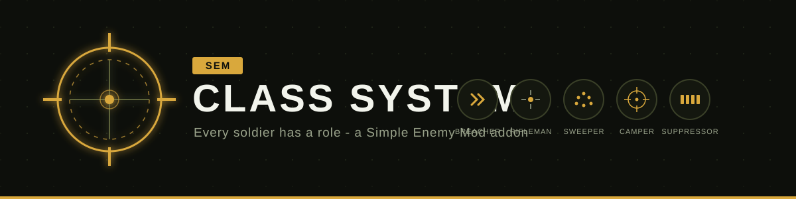

<p align="center">
  
</p>

<p align="center">
  <a href="https://github.com/Poseidon9991/SEM-ClassSystem">
    
  </a>
</p>

<p align="center">
  
  
  
  
</p>

***

## What is this?

**[SEM] Class System** is an addon for [Simple Enemy Mod](https://github.com/NekoYuni/Simple-Enemy-Mod-Public) that turns every soldier into a specialist. Instead of every unit sharing the same stats and pulling from the same gun pool, each soldier now spawns with a **class** — a combat role with its own weapon, its own way of shooting, and a nickname floating above its head.

A RU squad is no longer three identical riflemen. Now it can be a **Breacher** spraying an UZI up close, a **Camper** picking targets from a hill, and a **Suppressor** keeping heads down with an RPK.

> **Warning:** this addon is in early development. Back up your worlds before installing, and expect balance to change between versions.

***

## The Classes

Every unit rolls one of five classes when it spawns. The class controls which gun it carries, how fast it fires, how accurate it is, and the name tag it shows.

| Class | Nickname | Style | Weapons |
|---|---|---|---|
| **SMG** | Breacher | sprays fast, but shots scatter past mid-range | UZI / Vector / MP5 |
| **Rifle** | Rifleman | the balanced soldier you already know | AK-47, Type-81 / M4A1, SCAR-L / HK G3 |
| **Shotgun** | Sweeper | deadly up close, harmless far away | SPAS-12 / AA-12 |
| **Sniper & RPG** | Camper | slow, patient, rarely misses | SKS, RPG-7 / M107, AWP, RPG-7 / Mk14, RPG-7 |
| **Heavy MG** | Suppressor | long bursts that keep enemies pinned | RPK / M249 / Minigun |

> Nicknames are what show on the unit's name tag — a shotgun unit shows **US Unit - Sweeper**, not "Shotgun Class". You can rename every nickname in the config.

***

## Choosing a Class

You are not stuck with the dice roll — three ways to pick the specialist you want:

*   **Recruit Table** — **sneak + right-click** the table to cycle through classes (Random → Breacher → Rifleman → Sweeper → Camper → Suppressor), then right-click normally to recruit. Your pick is remembered between sessions.
*   **Command** — `/semcs recruit_class <class>` sets your table pick directly, and admins can use `/semcs spawn <ru|us|pmc> <class>` or re-class a living unit with `/semcs class <targets> <class>` (it swaps their gun too).
*   **Summoning** — `/summon` with NBT also works: `/summon simpleenemymod:pmcunit ~ ~ ~ {semcs_weapon_class:"SNIPER"}`

***

## Weapon Lock

A specialist only fights with specialist gear:

*   A **Camper** accepts only sniper weapons — you can't hand him a rifle in his inventory screen, he simply won't take it.
*   Even if a wrong-class weapon somehow ends up in his hands, he will **hold fire** rather than use it.
*   Guns from other mods or datapacks that aren't in the class tables stay allowed, so nothing gets bricked.

***

## Village Defenders

SEM units count as monsters to Minecraft — so iron golems, snow golems and guard mods like **Guard Villagers** attack *all* of them, even your own recruited PMCs.

This addon fixes the relationship: defenders never target a **protected faction**. Out of the box **PMC is protected** (they're your allies), while RU and US stay hostile — defenders still fight invaders. Flip it per faction in `[compat]`:

*   `defendersIgnoreRU` / `defendersIgnoreUS` / `defendersIgnorePMC`

Using Guard Villagers or another guard mod? Add its entity to the `sem_classsystem:unit_defenders` entity-type tag via datapack — one json file, no code. Golems are included by default.

Zombies and other hostile mobs still fight units normally — only defenders are filtered.

***

## Per-Faction Stats

On top of classes, each faction gets its own attribute set — no more shared stats:

*   **Health** — make RU units tankier than US units if you want
*   **Walk speed** — fast PMCs, slow RU heavies
*   **Detection range** — who spots you first
*   **Accuracy** — a faction-wide aim bonus or penalty that stacks with the class one

***

## Requirements

*   **Minecraft:** 1.20.1
*   **Forge:** 47.4.0+
*   **Dependency:** [Simple Enemy Mod](https://github.com/NekoYuni/Simple-Enemy-Mod-Public) `0.1.5-beta` up to `0.1.6` (includes `v0.1.6-beta.1`)
*   **Dependency:** [TaCZ](https://www.curseforge.com/minecraft/mc-mods/timeless-and-classics-zero) `1.1.4` – `1.1.8` (required by SEM itself)

This mod **will not load** without Simple Enemy Mod installed — that's the point, it extends it.

***

## Configuration

Everything is editable per-world:

`.minecraft/saves/[your world name]/serverconfig/sem_classsystem-server.toml`

**Per faction** (`[ru_unit]`, `[us_unit]`, `[pmc_unit]`):

*   `health`, `speed`, `detectionRange`, `accuracySpreadMultiplier`

**Per class** (`[class_tuning.smg]` etc.):

*   `nickname` — the name-tag suffix
*   `accuracySpreadMultiplier` — lower = more accurate
*   `rangeFalloffMultiplier` — higher = accuracy dies faster with distance
*   `burstLengthMultiplier` — shots per burst
*   `cooldownMultiplier` — pause between bursts (lower = higher fire rate)

Defaults match SEM's own values — the mod changes nothing until you ask it to.

***

## Custom Guns

Use a TaCZ addon gunpack? The class weapon tables are plain datapack files — the same way SEM loads its own guns. Drop a datapack into `saves/[your world]/datapacks/` with a file like:

`data/<my_pack>/class_loadouts/ru_units.json`

```json
{
  "classes": {
    "sniper": {
      "my_custom_rifle": {
        "gun_id": "mygunpack:big_iron",
        "ammo_count": 5,
        "fire_mode": "SEMI",
        "scope_id": "tacz:scope_mk5hd"
      }
    }
  }
}
```

*   Faction files: `ru_units.json`, `us_units.json`, `pmc_units.json`
*   Class keys: `smg`, `rifle`, `shotgun`, `sniper`, `heavy_mg`
*   `gun_id`, `ammo_count` and `fire_mode` are required; `scope_id`, `muzzle_id`, `grip_id` are optional
*   Your file **adds** guns to the class pool — our defaults still apply unless you override them
*   Guns listed here count as class weapons, so the Weapon Lock applies to them too. Guns listed nowhere stay usable by anyone.

Run `/reload` after editing. Check `latest.log` if a file doesn't load — bad entries are skipped with a warning, never crash.

***

## Credits

*   **[NekoYuni](https://github.com/NekoYuni)** — original author of **Simple Enemy Mod**. Every soldier, every behaviour, every system this addon builds on is his work. This mod exists because SEM does.
*   **[TaCZ team](https://www.curseforge.com/minecraft/mc-mods/timeless-and-classics-zero)** — the weapon system all units fight with.
*   **[neoalive](https://github.com/neoalive/tacz-simple-enemies-vehicular-warfare)** — the vehicular-warfare addon whose architecture inspired how this mod extends SEM.

## License

GPLv3 — same as Simple Enemy Mod. This addon is a derivative work: SEM is GPLv3, so this is too. Source stays open, credit stays attached.
