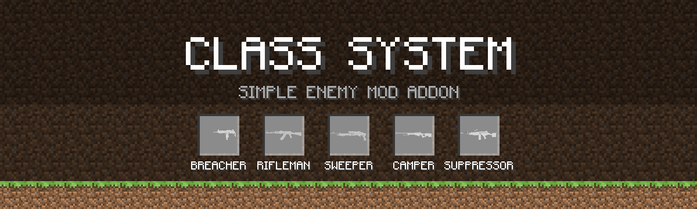

<p align="center">
  
</p>

<p align="center">
  <a href="https://github.com/Poseidon9991/Simple-Enemy-Mod-ClassSystem">
    
  </a>
</p>

<p align="center">
  
  
  
  
  
  
</p>

***

## What is this?

**[SEM] Class System** is an overhaul addon for [Simple Enemy Mod](https://github.com/NekoYuni/Simple-Enemy-Mod-Public) that transforms every soldier into a battlefield specialist. Instead of every unit sharing identical stats and drawing from a generic gun pool, soldiers now spawn with a **specialized combat class** — complete with custom tactical AI, ballistic prediction, authentic weapon attachments, tailored armor sets, and clear role identification.

A squad is no longer three identical riflemen. Now you'll face a **Breacher** pushing close with an SMG, a **Camper** calculating ballistic lead from a ridge, a **Suppressor** laying down continuous tracer fire to pin targets, a **Demolisher** walking explosive rounds over cover, and an adaptive **Jack** dynamically flexing between combat roles.

On top of specialized AI, this addon adds **10 custom 3D GeckoLib tactical armor sets** (41 pieces total) with tailored bullet-damage resistance and survival recipes, **BHQ elite operators**, **field medics and self-heal logistics**, **squad command tools** (Field Tablet, Rally Whistle, Guard Posts, chunk-claim map control), **night raid ambushes**, **unit veterancy**, **Xaero's World Map integration**, **WTHIT (WAILA) HUD support**, and a dedicated creative tab with **33 custom spawn eggs**.

> **Note:** This addon is built for Minecraft 1.20.1 (Forge). Back up your worlds before installing, and tweak the common configuration to match your pack's balance.

***

## The Classes

Every soldier rolls one of eight main combat classes upon spawning. The class governs which weapons the unit will accept, how it positions itself, its fire cadence and dispersion, its squad flanking behavior, and its specialized combat mechanics.

| Class | Nickname | Accent Color | Combat Style & Behavior | Standard Weapons |
|---|---|---|---|---|
| **SMG** (`smg`) | **Breacher** | Amber (`#D9A62E`) | Fast-firing, aggressive skirmisher. Flanks cover almost immediately and pushes in tight (~25 blocks). High spread past mid-range. | UZI, Vector, HK MP5A5 |
| **Rifle** (`rifle`) | **Rifleman** | Steel Gray (`#8C8C8C`) | The versatile frontline infantryman. Maintains standard spacing (~60 blocks) and reliable burst accuracy. | AK-47, Type-81, M4A1, SCAR-L, HK G3, QBZ-95/191 |
| **Shotgun** (`shotgun`) | **Sweeper** | Breaching Red (`#B0402C`) | Ruthless room-clearer. Charges into point-blank range (~12 blocks), activates CQB tactics early, and continues charging even when heavily wounded. | SPAS-12, AA-12, Remington M870 |
| **Sniper** (`sniper`) | **Camper** | Recon Blue (`#3E6EA8`) | Dedicated long-range marksman (~105+ blocks). Takes a knee, scopes in, and calculates ballistic aim lead. Kites backward when pressed and arcs around targets. | SKS Tactical, Dragunov SVD, M107, AI AWP, Mk14 EBR |
| **Heavy MG** (`heavy_mg`) | **Suppressor** | Suppression Purple (`#7B4FA6`) | Sustained fire support platform (~55 blocks). Braces in a crouch to fire full tracer streams. Suppresses players and hostiles in a 14-block impact radius. | RPK, M249 SAW, M134 Minigun |
| **Heavy / Ordnance** (`heavy`) | **Demolisher** | Ordnance Orange (`#C97B1E`) | Explosive ordnance specialist (~42 blocks). Employs indirect fire over obstacles with lobbed shells, targets hostile clusters, and auto-corrects aim between shots. | RPG-7, Panzerfaust, MGL-320, MGL-40, MGL-416, M202 |
| **Generalist** (`jack`) | **Jack** | Ranger Green (`#5C8A4D`) | Flexible combat operator. Bypasses class weapon lock (can use any gun). Dynamically shifts engagement distance, approach speed, and stances based on the held weapon. | Any weapon in the arsenal (AK-47, M4A1, MP5, M870, etc.) |
| **Medic** (`medic`) | **Medic** | Medical Red (`#D63A3A`) | Corpsman. Fights with a sidearm but breaks off to treat wounded allies — moves to any hurt teammate within 24 blocks and patches them up, consuming stocked bandages/medkits for a big heal or applying a free field dressing. | P320, M1911 (faction sidearms) |

***

### Advanced Class AI Mechanics

*   **Camper Ballistic Aim & Scoped Marksmanship:**
    *   **Scoped Precision:** Asserts TaCZ aim state (`aimingProgress == 1.0`) before discharging. Will hold fire until fully scoped rather than suffering hip-fire spread.
    *   **Ballistic Lead & Drop Compensation:** Intercepts the target position to calculate target velocity × bullet flight ticks (using the gun's real projectile velocity) and offsets aim upward for bullet gravity ($0.5 \times g \times t^2$).
    *   **Anti-Monster Lethality:** Gains 40% tighter spread and full lead against monsters (zombies, skeletons), while remaining dodgeable (~75% hit rate) for moving players.
    *   **Tactical Kiting & Shoot-and-Scoot:** Back-pedals if a target closes within 20 blocks (`tacticalKiteDistance: 20.0`). Every 2 landed hits triggers a 60–90° repositioning arc around the target.
*   **Suppressor Area Suppression:**
    *   Braces in a steady kneeling stance to maintain sustained automatic fire with visible tracer streams.
    *   Bullet impacts inflict a suppression aura on players in a **14-block radius at 1.4× strength** (unlike default SEM which only suppresses with RU/US, this works across all factions including PMC and BHQ).
*   **Demolisher Indirect Fire & Self-Correcting Artillery:**
    *   **Indirect Fire:** When wielding curved-trajectory launchers (MGL grenade launchers), Demolishers bypass line-of-sight requirements to lob shells over walls and cover.
    *   **Cluster Targeting:** Aims at the centroid of hostile groups (3+ enemies within 5 blocks) to maximize explosive splash damage.
    *   **Impact Correction Loop:** Watches projectile entities in flight and scores the impact against the target line. Short rounds raise the next aim point and long rounds lower it, walking shots directly onto target.
    *   **Safety Standoff:** Maintains a 16-block safety standoff (`tacticalKiteDistance: 16.0`) to avoid self-splash damage.
*   **Jack Adaptive Stance:**
    *   A versatile wild card that can equip any gun type.
    *   Its engage distance, max firing range, and approach speed dynamically recalculate on the fly based on the equipped weapon (closes to 14 blocks with a shotgun, stands at 90 with a rifle/sniper, maintains 42 with a launcher).

***

### The Pistol Subclass (Sidearm)

Pistols are not rolled at spawn — they are a **universal subclass** that any soldier can adopt:
*   Place any pistol in a unit's main hand via its inventory screen (pistols bypass the weapon lock for every class).
*   The soldier immediately adopts sidearm combat behavior: rapid semi-auto cadence (0.7× cooldown), tight close-to-mid range accuracy, and fluid movement around 30 blocks.
*   The soldier's core class and role title remain intact. Swapping back to a class weapon instantly restores its primary combat behavior.
*   Faction sidearms: RU → CZ75, US → M1911 / P320, PMC → Glock 17 / Desert Eagle, BHQ → Desert Eagle / Timeless .50.

***

## Field Medicine & Combat Logistics

*   **Medic Behavior:** Medics fight like light infantry, but when a same-faction unit, SEM ally, squadmate, or their owner player is hurt within 24 blocks, they move in and heal them every ~1.25 s. Consuming a stocked bandage/medkit/potion restores **8 HP**; with no supplies they still apply a free **3 HP** field dressing (with heart particles + sound feedback).
*   **Unit Self-Heal:** Wounded units autonomously consume food, bandages, medkits, and beneficial potions from their storage, nested bags/pouches, or Curios slots — even mid-fight (they retreat to cover while eating). Golden Apples are eaten at full HP to gain Absorption. RU/US units without a storage grid carry built-in **field rations** instead.
*   **Ammo Fallback:** When a unit's magazine runs dry *and* no matching rounds exist anywhere in its inventory, it automatically swaps to the best armed weapon it carries (the issued backup sidearm or any loaded gun), then swaps back to its primary once the player restocks ammunition.
*   **Curios on Units:** Curios slots adapt dynamically to all registered slot types, and artifact-style effects are bridged onto soldiers — including **Totem of Undying death protection** from Curios, offhand, or storage, plus night-vision goggles, invisibility scarves, running shoes, antidotes, and offensive charms (Power/Fire/Vampiric Gloves, thorn pendants).

***

## Squad Command & Map Control

### Squad Rally Whistle

*   **Right-click:** Rally every unit you own within 64 blocks — they drop locks and fall in behind you (`FOLLOW_COMMANDER`), or into the whistle's current formation.
*   **Sneak + right-click:** Cycle the march order — `FOLLOW` → `WEDGE` → `COLUMN` — and apply it immediately. Craftable from iron.

### Field Tablet (SEM-OS)

A squad command PDA (glass pane + iron + redstone). Right-click boots the SEM-OS desktop; the Squad app lists every owned unit's health, ammo supply (including infinite creative ammo boxes), class, and food/medical status — all fed by server-synced data. Also includes a teleport app that recalls selected units to you or to a marked position.

### Chunk Claims, Duty & Guard Posts

With or without a map mod, the server tracks **per-player chunk claims** (persisted in overworld SavedData):

*   **Claim chunks** from the world-map right-click menu (or hold territory for your squad).
*   **Assign duty** to owned units: **Guard** (hold the chunk centre), **Patrol** (loop inside it), **Perimeter** (walk the boundary of the whole connected claim patch), or a custom waypoint **Route** plotted on the map.
*   **Guard Post blocks** (smooth stone + iron + redstone + glowstone) bind up to two units as **primary + reserve**; when the primary is cleared or teleported away, the reserve automatically steps up.
*   Claims are limited per dimension (`maxClaimedChunks`, default 64) and new claims must border existing territory (`requireContiguousClaims`).

### Xaero's World Map & Minimap Integration (optional)

When Xaero's World Map is installed, the map becomes a real RTS surface:

*   Every owned unit renders as a **live faction-colored marker** (health, class, order, duty, veterancy rank) anywhere in the dimension; hostile units within 160 blocks appear as spotted contacts.
*   **Right-click orders:** claim/unclaim chunks, assign guard/patrol/perimeter duty, plot patrol routes, designate targets, teleport or return units to their posts.
*   Your claims paint as a colored overlay (green for yours, amber for others'), and night-raid pings pulse on the map.
*   Fully soft-dependent — the mod runs fine without Xaero; claims and duty logic still work, only the map UI is absent.

### Squad Teamwork & Veterancy

*   **Radio Target Sharing:** When one unit spots an enemy squad, it broadcasts the contact to allied units within 48 blocks and distributes targets across the enemy team — squads spread fire instead of leaving one soldier alone.
*   **Anti-Bunching Strafe:** Stacked squadmates automatically spread into a firing line, and mobile classes take short lateral combat strafes while engaging.
*   **Veterancy:** Units earn XP in combat and gain persistent rank titles (shown on markers and the tablet), stored in entity NBT.
*   **Night Raids:** Once per night each player rolls `chancePerNight` (default ~1 in 3); on success a hostile RU or US patrol spawns `spawnDistance` blocks away and hunts your position — with a map ping warning.
*   **Squad Size Cap:** Recruitment is limited to `maxOwnedUnits` per player (default 32, `0` = unlimited) to keep servers balanced.

***

## Tactical 3D Armor Sets (GeckoLib)

The mod includes **10 complete tactical armor sets (41 individual pieces)** with custom 3D models and textures powered by **GeckoLib**. Each set renders in full 3D on both **players** and **soldiers**, featuring tailored defense, durability, toughness, knockback resistance, and authentic TaCZ bullet-reduction stats.

<p align="center">
  <i>All 41 armor pieces are craftable in survival and accessible in the creative tab.</i>
</p>

### Armor Sets Overview

1.  **BHQ Tactical Set** *(5 pieces)* — Modeled after real Bodyguard Headquarters operators: matte-black high-cut ballistic helmet (NVG mount, side flashlights, goggles resting on the brow) or multicam patrol cap, multicam uniform with black gloves under a black MOLLE plate carrier (BHQ tape + Cambodian flag on the chest, BHQ tape and unit emblem on the sleeve), multicam combat pants with black belt and large knee pads, and tactical combat boots.
2.  **911 Special Forces Set (Cambodia)** *(4 pieces)* — Special Forces counter-terror kit: signature red beret with 911 crest, tiger-stripe tactical chest rig with chest rope, tiger-stripe combat pants, and jungle boots.
3.  **GRK (Royal Gendarmerie) Set** *(4 pieces)* — Modeled after Royal Gendarmerie tactical units: black helmet with goggles on the brow and dark glasses, dark navy uniform with black gloves, dark carrier with a large radio pouch, mag pouches and ID card, Gendarmerie emblem on the left sleeve and Cambodian flag on the right, navy cargo pants with black duty belt, drop-leg holster, thigh pockets and knee pads, and enforcement boots.
4.  **RAF (Royal Cambodian Armed Forces) Set** *(4 pieces)* — Modeled after RCAF infantry: large-blotch woodland camo, round camo-covered helmet with chin strap, olive rucksack-style shoulder straps with buckles, olive web belt and ID card, unit patch on the left sleeve and Cambodian flag on the right, woodland cargo pants with blousing bands, and infantry jungle boots.
5.  **Camper (Recon / Sniper) Set** *(4 pieces)* — Jungle-camo boonie hat with leaf net and foliage tufts, slim chest rig with integrated rangefinder pouch, ghillie leaf-stitched pants, and silent recon boots.
6.  **Suppressor (Heavy Gunner) Set** *(4 pieces)* — Heavy ballistic steel-camo helmet with counterweight and side rails, juggernaut plate carrier with ammo belt, heavy pauldrons and collar, reinforced knee-plate pants, and steel-toe boots.
7.  **Demolisher (EOD / Ordnance) Set** *(4 pieces)* — Blast muff helmet with amber ballistic goggles and top rail, black ordnance vest with grenade loops and back-mounted launcher tube, heavy blast-guard cargo pants, and steel-reinforced EOD boots.
8.  **PMC Contractor Set** *(4 pieces)* — Private-military operator kit: Ops-Core FAST ballistic helmet, Contractor Plate Carrier, Operator Cargo Pants, and Contractor Tactical Boots.
9.  **RU Ratnik Set** *(4 pieces)* — Russian infantry kit: Ratnik 6B47 ballistic helmet, 6B45 plate carrier, VKPO EMR combat trousers, and Ratnik combat boots.
10. **US IOTV Set** *(4 pieces)* — American infantry kit: ACH ballistic helmet, IOTV tactical plate carrier, OCP combat pants, and Coyote combat boots.

### Armor Stats & TaCZ Bullet Protection

TaCZ splits projectile hits into regular bullet damage (`tacz:bullet`, mitigated by armor) and armor-ignoring damage (`tacz:bullet_ignore_armor`). Armor defense and toughness directly determine how much rifle and sniper fire is absorbed.

| Armor Set | Defense (H/C/L/B) | Toughness | Knockback Res. | Durability Mult. | Repair Material | Damage Reduction *(vs 9-dmg bullet)* |
|---|---|---|---|---|---|---|
| **Camper** | 3 / 5 / 3 / 2 (13) | +0.5 | 0.0 | ×16 | Leather | **~38%** (Light Recon) |
| **RAF** | 4 / 5 / 3 / 2 (14) | +0.25 | 0.0 | ×14 | String | **~40%** (Light Infantry) |
| **911 SF** | 3 / 6 / 4 / 2 (15) | +0.75 | 0.0 | ×18 | Iron Ingot | **~47%** (Medium Commando) |
| **GRK** | 5 / 7 / 4 / 2 (18) | +1.0 | +0.10 | ×24 | Iron Ingot | **~60%** (Riot / Security) |
| **BHQ** | 3 / 7 / 6 / 3 (19) | +1.5 | +0.05 | ×26 | Iron Ingot | **~66%** (Elite Bodyguard) |
| **RU Ratnik** | 3 / 7 / 5 / 3 (18) | +1.0 | 0.0 | ×26 | Iron Ingot | **~60%** (Standard Infantry) |
| **Demolisher** | 4 / 8 / 5 / 3 (20) | +2.5 | +0.25 | ×36 | Diamond | **~72%** (Heavy Blast / EOD) |
| **US IOTV** | 3 / 8 / 6 / 3 (20) | +1.5 | +0.05 | ×28 | Iron Ingot | **~68%** (Modern Infantry) |
| **PMC Contractor** | 4 / 8 / 6 / 3 (21) | +1.5 | +0.10 | ×30 | Netherite Scrap | **~70%** (Elite Operator) |
| **Suppressor** | 4 / 9 / 6 / 3 (22) | +2.0 | +0.20 | ×40 | Netherite Ingot | **~79%** (Maximum Ballistic) |

### Survival Crafting Recipes

All 41 pieces are crafted on a vanilla Crafting Table. The faction sets use themed shaped recipes (e.g. vests built around an iron chestplate with faction-colored wool and leather), while class sets reinforce standard armor shapes with special center materials:
*   **Camper Set:** Leather base + Gold Ingot center core.
*   **RAF Set:** String & Leather base + Iron Ingot center core.
*   **911 SF Set:** Leather & Iron Ingot base + Iron Ingot center core.
*   **GRK Set:** Iron Ingot base + Copper Ingot center core.
*   **BHQ Set:** Iron Ingot base + Diamond center core.
*   **Demolisher Set:** Diamond base + Iron Block center core.
*   **Suppressor Set:** Diamond base + Netherite Ingot center core.
*   **PMC / RU / US Sets:** Iron chestplate core + leather and faction-colored wool (black, green, and yellow respectively).

***

## HUD & Unit Identification

*   **WTHIT (WAILA) Integration:** When looking at any classified soldier, WTHIT displays a clean HUD element showing the soldier's faction and class nickname in the class's signature accent color (e.g., Recon Blue for Campers, Ordnance Orange for Demolishers).
*   **Equipment GUI Display:** Opening a unit's inventory displays its role directly in the window title (e.g., `PMC Unit Equipment - Camper`, `BHQ Unit Equipment - Demolisher`), alongside a color-coded role badge.
*   **Clean World Visuals:** Auto-generated overhead nameplate tags have been removed to prevent world clutter. Units display their natural faction nameplate, and player-applied name tags via Name Tags remain fully supported.

***

## Choosing a Class

You have complete control over squad composition:

1.  **Recruit Table & BHQ Recruit Table:**
    *   **Right-Click** the table to open the class-selection screen — class cards for every role plus **Random**, each in its accent color.
    *   Click a card to set your preference, or use the recruit buttons to hire immediately. Your selection is saved to your player profile.
2.  **Commands:**
    *   `/semcs recruit_class [class|random]` — View or set your recruiting preference.
    *   `/semcs spawn <ru|us|pmc|bhq> <class>` — Admin command to spawn a specific faction specialist.
    *   `/semcs class <targets> <class>` — Admin command to instantly re-class living units (automatically updates gear).
3.  **Creative Spawn Eggs & Dedicated Tab:**
    *   The mod registers its own **SEM Class System** creative tab (`itemGroup.sem_classsystem`) housing all armor, items, and eggs.
    *   Includes **32 Class Spawn Eggs** (4 factions × 8 main classes, matching faction shell colors and class accent spots) plus the **BHQ Operator Spawn Egg**. Units spawned from class eggs immediately lock to that class and draw proper loadouts.
4.  **Summon Command:**
    *   `/summon simpleenemymod:pmcunit ~ ~ ~ {semcs_weapon_class:"SNIPER"}`
    *   `/summon sem_classsystem:bhqunit ~ ~ ~ {semcs_weapon_class:"HEAVY"}`

***

## Strict Weapon Lock

A specialist strictly requires specialist gear:
*   A **Camper** accepts only sniper rifles and DMRs. Attempting to place an assault rifle or shotgun in their inventory slot will be rejected.
*   **Pistols are exempt** for all classes (see the Pistol Subclass above).
*   **Jacks are exempt** and can wield any firearm in the game.
*   If a unit somehow holds an invalid weapon, its combat AI will **hold fire** rather than shoot blindly.
*   Unregistered guns from third-party gunpacks are classified by their native TaCZ weapon type (`tacz:gun` tags), keeping addon packs fully compatible.

***

## BHQ Operators

Inspired by Cambodia's Bodyguard Unit, the **BHQ** is an elite faction built on the PMC framework:

*   **Superior Attributes:** 35 Max HP, 0.30 movement speed, 112 block detection range, and a 0.65 accuracy spread multiplier.
*   **Field Command Recruit Table:** Features a custom 3D model styled as a field command desk with a topographical map, military field radio with whip antenna, tactical laptop, ammo crate, and Cambodian flag. Craftable with black concrete, iron, and an emerald.
*   **Curios API Support:** Full built-in Curios entity integration (`head`, `back`, `body`, and `belt` slots) with custom empty-slot icons and GUI support.
*   **Six Tactical Skins:** Variants featuring authentic woodland camouflage and Royal Gendarmerie (GRK) navy uniforms with balaclavas, skull masks, sunglasses, and berets.
*   **Elite Arsenal:** Draws from an elite loadout pool with pre-fitted tactical attachments (Vector, SCAR-H, HK416, AA-12, Dragunov SVD, M107, RPK, MGL-320).

***

## Ammunition Reserves & Pre-Fitted Attachments

*   **Automated Ammo Reserves:** Units no longer run out of ammunition mid-fight. Upon spawning or equipping, units receive reserve ammo stacks (topping up to **254 rounds** of matching ammunition) in their inventory storage slots.
*   **Faction-Themed Attachments:** All faction loadout tables come pre-configured with authentic TaCZ attachments:
    *   **RU:** OKP-7, PK-06, Pioneer muzzle brakes, RK-1 grips, extended magazines.
    *   **US:** ELCAN Specter 4x, EOTech EXP3, Ursus silencers, Talon vertical grips, SE-5 grips.
    *   **PMC:** Aimpoint T2, HAMR scopes, Knight QD silencers, SE-5 grips.
    *   **BHQ:** EOTech 552, QMK-152 scopes, Ursus silencers, RK-1 grips, extended magazines.

***

## Village Defenders Compatibility

In base SEM, units extend Minecraft's `Monster` class, causing Iron Golems, Snow Golems, and guards from mods like **Guard Villagers** to attack all units — even friendly recruited PMCs.

This addon fixes that relationship: defenders never target protected allied factions. By default, **PMC and BHQ are protected** (allies), while RU and US remain hostile.
Configure this in `[compat]`:
*   `defendersIgnoreRU`, `defendersIgnoreUS`, `defendersIgnorePMC`, `defendersIgnoreBHQ`

You can add any guard mod entity to the `#sem_classsystem:unit_defenders` entity-type tag via datapack.

***

## Requirements

*   **Minecraft:** `1.20.1`
*   **Minecraft Forge:** `47.4.0+`
*   **Hard Dependency:** [Simple Enemy Mod](https://github.com/NekoYuni/Simple-Enemy-Mod-Public) (`0.1.5-beta` through `0.1.6`)
*   **Hard Dependency:** [TaCZ](https://www.curseforge.com/minecraft/mc-mods/timeless-and-classics-zero) (`1.1.4` – `1.1.8`)
*   **Hard Dependency:** [GeckoLib 4](https://www.curseforge.com/minecraft/mc-mods/geckolib) (`4.4+`) — required for 3D armor rendering.
*   **Recommended / Compatible Mods:**
    *   [WTHIT (WAILA)](https://www.curseforge.com/minecraft/mc-mods/wthit-forge) — for in-game unit class HUD popups.
    *   [Curios API](https://www.curseforge.com/minecraft/mc-mods/curios) — for unit curios accessory slots.
    *   **Xaero's World Map + Minimap** — unlocks live unit markers, chunk claims, and map-based squad orders.
    *   [Guard Villagers](https://www.curseforge.com/minecraft/mc-mods/guard-villagers) — fully compatible with defender rules.

***

## Configuration

Configuration is located globally in:
`.minecraft/config/sem_classsystem-common.toml`

### Faction Attributes (`[ru_unit]`, `[us_unit]`, `[pmc_unit]`, `[bhq_unit]`)
*   `health` — Max health of faction soldiers (default 20.0, BHQ 35.0).
*   `speed` — Base walk speed (default 0.27, BHQ 0.30).
*   `detectionRange` — Target spotting range in blocks (default 96.0, BHQ 112.0).
*   `accuracySpreadMultiplier` — Faction bullet dispersion multiplier (default 1.0, BHQ 0.65).

### Class Combat Tuning (`[class_tuning.<class>]`)
*   `nickname` — Role name displayed in GUI titles and WAILA tooltips.
*   `accuracySpreadMultiplier` — Base dispersion multiplier (lower = tighter).
*   `rangeFalloffMultiplier` — Accuracy degradation over distance.
*   `burstMultiplier` — Number of shots per burst.
*   `cooldownMultiplier` — Delay between bursts (lower = faster cadence).
*   `engageDistance` — Optimal spacing distance before holding ground.
*   `shootDistanceMultiplier` — Maximum range at which the unit opens fire.
*   `approachSpeedMultiplier` — Movement speed while advancing toward targets.
*   `crouchWhileFiring` — Whether the unit kneels/crouches to fire (Campers and Suppressors).
*   `tacticalPatienceMultiplier` — Patience before flanking when line of sight is broken.
*   `tacticalFlankDurationMultiplier` — Duration of flanking arcs before committing.
*   `tacticalRushSpeedMultiplier` — Speed of flanking rushes.
*   `tacticalForcedRush` — Set to `false` for hold-position classes (Camper, Suppressor, Demolisher) so they re-arm flank arcs instead of suicide charging.
*   `tacticalRetreatHealthMultiplier` — Low-health cover threshold.
*   `tacticalCloseRangeMultiplier` — CQB combat threshold distance.
*   `tacticalKiteDistance` — Back-pedal distance when enemies approach too close (Camper 20.0, Demolisher 16.0).

### Squad & World Systems
*   `[general] maxOwnedUnits` — Per-player squad size cap (default 32, `0` = unlimited).
*   `[bhq_recruit] price` — Recruit-item cost for a BHQ operator (default 32).
*   `[night_raids]` — `enabled`, `chancePerNight`, `squadSizeMin`/`squadSizeMax`, `spawnDistance` for the night ambush events.
*   `[map]` — `maxClaimedChunks` (default 64) and `requireContiguousClaims` for the chunk-claim system.

***

## Custom Guns & Datapacks

Want to add custom guns from addon packs (e.g. SFMS, LRADD, BF1, MaxStuff) to the class pools? Simply drop a datapack into `datapacks/` with a loadout JSON:

`data/<your_pack>/class_loadouts/<faction>_units.json`

```json
{
  "classes": {
    "sniper": {
      "cheytac_m200": {
        "gun_id": "mygunpack:m200",
        "ammo_count": 7,
        "fire_mode": "SEMI",
        "scope_id": "tacz:scope_mk5hd"
      }
    },
    "heavy": {
      "mgl": {
        "gun_id": "sfms:mgl40",
        "ammo_count": 6,
        "fire_mode": "SEMI"
      }
    }
  }
}
```

*   **Factions:** `ru_units.json`, `us_units.json`, `pmc_units.json`, `bhq_units.json`.
*   **Supported Classes:** `smg`, `rifle`, `shotgun`, `sniper`, `heavy_mg`, `heavy`, `jack`, `medic`, and `pistol`.
*   **Optional Attachments:** `scope_id`, `muzzle_id`, `grip_id`.
*   Entries merge seamlessly with built-in pools upon running `/reload`. Missing or uninstalled weapon IDs are cleanly skipped without crashes.

***

## Credits

*   **[NekoYuni](https://github.com/NekoYuni)** — Creator of the exceptional [Simple Enemy Mod](https://github.com/NekoYuni/Simple-Enemy-Mod-Public). This addon is built upon SEM's foundational systems, entity models, and AI framework.
*   **[TaCZ Team](https://www.curseforge.com/minecraft/mc-mods/timeless-and-classics-zero)** — Authors of the Timeless and Classics Zero firearm engine.
*   **[GeckoLib](https://geckolib.com/)** — Powers the 3D entity and armor rendering pipeline.

## License

GPLv3 — Inherited from Simple Enemy Mod. Source code remains open, and credit stays attached.
