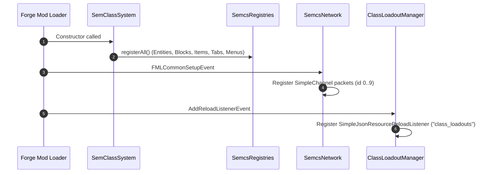
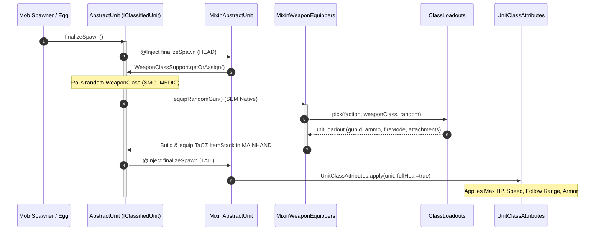

# [SEM] Class System — Developer Architecture & Codeflow Guide

> **Target Version:** Minecraft 1.20.1 | Forge 47.4.0+ | Java 17  
> **Mappings:** Parchment 1.20.1 (2023.09.03)  
> **Key Dependencies:** Simple Enemy Mod (SEM), Timeless and Classics Zero (TaCZ), GeckoLib 4  
> **Soft Dependencies:** Curios API, Xaero's World Map / Minimap, WTHIT  

---

## 📑 Table of Contents

1. [Architecture & Design Philosophy](#1-architecture--design-philosophy)
2. [Source Directory & Package Topology](#2-source-directory--package-topology)
3. [Core Lifecycles & Execution Flows](#3-core-lifecycles--execution-flows)
   - [Boot & Registration Lifecycle](#boot--registration-lifecycle)
   - [Unit Spawn & Classification Flow](#unit-spawn--classification-flow)
   - [Persistence & World Migration](#persistence--world-migration)
4. [The Combat & Tactical AI Engine](#4-the-combat--tactical-ai-engine)
   - [The Two-Axis Identity Model](#the-two-axis-identity-model)
   - [Effective Class Resolution](#effective-class-resolution)
   - [AI Goal Priority Stack](#ai-goal-priority-stack)
   - [Class Tactical Implementations](#class-tactical-implementations)
   - [Unit Needs & Morale System](#unit-needs--morale-system)
5. [Data-Driven Gun Tables & Datapack Pipeline](#5-data-driven-gun-tables--datapack-pipeline)
6. [3D GeckoLib Armor & Entity Rendering Pipeline](#6-3d-geckolib-armor--entity-rendering-pipeline)
7. [Networking & Synchronization Protocol](#7-networking--synchronization-protocol)
8. [Soft-Dependency Isolation Architecture](#8-soft-dependency-isolation-architecture)
9. [Step-by-Step Developer Recipes](#9-step-by-step-developer-recipes)
   - [Adding a Gun to a Class Loadout](#recipe-1-adding-a-gun-to-a-class-loadout)
   - [Adding a New Combat Class](#recipe-2-adding-a-new-combat-class)
   - [Adding a New Network Packet](#recipe-3-adding-a-new-network-packet)
   - [Adding a New GeckoLib Tactical Armor Set](#recipe-4-adding-a-new-geckolib-tactical-armor-set)
10. [Conventions, Code Standards & Safety Rules](#10-conventions-code-standards--safety-rules)

---

## 1. Architecture & Design Philosophy

`sem_classsystem` is an advanced modular extension for **Simple Enemy Mod (SEM)**. It bridges SEM's entity architecture with **Timeless and Classics Zero (TaCZ)** ballistics and **GeckoLib 4** 3D modeling, elevating generic soldiers into tactical specialists.

```
+-----------------------------------------------------------------------+
|                             MINECRAFT 1.20.1                          |
+------------------------------------+----------------------------------+
                                     |
               +---------------------+---------------------+
               |                                           |
    +----------v----------+                     +----------v----------+
    |   Simple Enemy Mod  |                     |        TaCZ         |
    |  (AbstractUnit, AI) |                     | (Guns, Ammo, Logic) |
    +----------+----------+                     +----------+----------+
               |                                           |
               +---------------------+---------------------+
                                     |
                       +-------------v-------------+
                       |    sem_classsystem        |
                       |  - IClassifiedUnit Bridge |
                       |  - Tactical AI & Tuning   |
                       |  - Datapack Gun Tables    |
                       |  - GeckoLib 3D Armors     |
                       |  - Squad Tablet & Map UI  |
                       +---------------------------+
```

### Core Architectural Pillars

1. **Non-Invasive Interface Bridging (`IClassifiedUnit`)**:
   Instead of creating subclass-locked copies of SEM units, the mod patches SEM's root `AbstractUnit` using Mixins to implement `IClassifiedUnit`. Every native SEM soldier (`RUunitEntity`, `USunitEntity`, `PmcUnitEntity`, plus our `BhqUnitEntity`) seamlessly gains class fields, persistence, and state.
2. **Effective Class Resolution (`getEffective`)**:
   Soldiers have an assigned base role, but their real-time behavior adapts dynamically based on the weapon currently held (e.g., sidearm subclass behavior overlays when holding a pistol; Jack adapts to any weapon type).
3. **Strict Separation of Soft Dependencies**:
   Integrations with Curios and Xaero's World Map/Minimap are strictly gated behind `AbstractSoftDepMixinPlugin` and reflective/mod-loaded checks. If Xaero or Curios is missing, the mod runs with zero crashes or missing-class warnings.
4. **Data-Driven Arsenal**:
   No gun IDs or attachment configurations are hardcoded. Everything is resolved through datapack JSONs (`data/*/class_loadouts/*.json`) loaded by `ClassLoadoutManager`.

---

## 2. Source Directory & Package Topology

The Java sources are structured under `src/main/java/com/poseidon/sem_classsystem/`:

```
com.poseidon.sem_classsystem/
├── SemClassSystem.java                  # Mod entrypoint (@Mod)
├── block/                              # Custom interactive world blocks
│   ├── BhqRecruitTableBlock.java       # BHQ elite recruitment workstation
│   ├── GuardPostBlock.java             # Guard billet anchor block
│   ├── GuardPostBlockEntity.java       # Primary/reserve unit binding logic
│   ├── SupplyCrateBlock.java           # Ration Crate (squad pantry block)
│   └── SupplyCrateBlockEntity.java     # 27-slot chest container + ITEM_HANDLER
├── bridge/                             # Injected interfaces for SEM classes
│   └── IClassifiedUnit.java            # Bridge interface for AbstractUnit
├── client/                             # Client-side UI, models, renderers
│   ├── BhqArmorModel.java              # GeckoLib 3D armor model
│   ├── BhqUnitRenderer.java            # BHQ unit entity renderer & skin variants
│   ├── ClientEventHandlers.java        # Overlay & key/event hooks
│   ├── ClientPacketHooks.java          # Client-bound packet execution
│   ├── CuriosClientSupport.java        # Soft-dep Curios client layer
│   ├── GuardPostScreen.java            # Guard post assignment GUI
│   ├── RecruitTableScreen.java         # Class selector buttons for recruit table
│   ├── SemcsArmorItemRenderer.java     # GeckoLib armor item renderer
│   ├── TabletScreen.java               # SEM-OS desktop (Squad, Teleport, Intel apps)
│   ├── UnitMarkerStore.java            # Client-side cache of synced units
│   ├── UnitProceduralAnimState.java    # Dynamic animation smoothing
│   └── xaero/                          # XAERO MAP INTEGRATION (Strictly isolated!)
│       ├── SemcsXaeroCompat.java       # Map overlay element registration
│       ├── SemcsMinimapCompat.java     # Minimap element registration
│       ├── RoutePlot.java              # Waypoint path visualizer
│       └── UnitMarkerElements.java     # Unit radar pips and order pins
├── commands/                           # In-game console commands (/semcs)
│   └── SemClassCommands.java           # Spawn, class assignment, territory commands
├── compat/                             # External mod compatibility hooks
│   ├── CuriosUnitEffectsHandler.java   # Passes Curios trinket effects to units
│   ├── UnitDefenseCompat.java          # Protects PMCs from Iron/Snow Golems
│   └── wthit/SemcsWailaPlugin.java     # WAILA/WTHIT tooltip display
├── config/                             # Forge TOML configuration
│   └── ClassSystemConfig.java          # Common & Server config definitions
├── data/                               # Datapack reload listeners
│   └── ClassLoadoutManager.java        # Parses class_loadouts/*.json & builds cache
├── entity/                             # Concrete mob entities
│   ├── BhqUnitEntity.java              # Cambodian Bodyguard Unit (Elite PMC)
│   └── ai/                             # Tactical AI goals
│       ├── StockpileSearch.java        # Shared claimed-container scan/withdraw
│       ├── UnitChunkDutyGoal.java      # Guard post & chunk patrol logic
│       ├── UnitEatGoal.java            # Hunger: carried food + stockpile runs
│       ├── UnitResupplyGoal.java       # Ammo: dry-gun stockpile runs
│       ├── UnitAmmoBoxGoal.java        # Ammo: worn tacz:ammo_box curio feed
│       ├── UnitMedicHealGoal.java      # Medic triage & healing behavior
│       ├── UnitMeleeAttackGoal.java    # Bayonet/knife CQB fallback
│       ├── UnitLootGoal.java           # Post-battle scavenge of useful drops
│       ├── UnitSelfHealGoal.java       # Autonomous bandaging/food consumption
│       ├── UnitSleepGoal.java          # Energy: claims beds inside owner claims
│       └── UnitWeaponFallbackGoal.java # Empty-mag sidearm swapping
│   ├── DownedState.java                # Downed-not-dead NBT state helpers
├── event/                              # Forge bus event subscribers
│   ├── GuardPostEvents.java            # Billet promotion & fallback checks
│   ├── NightRaidEvents.java            # Ambush raid scheduling director
│   ├── UnitBackupCall.java             # Squad wounded distress alerts (<25% HP)
│   ├── UnitDownedEvents.java           # Downed/bleedout/revive hooks (game bus)
│   ├── UnitEffectsEvents.java          # Unit gunfire VFX (muzzle flash, impact sparks)
│   ├── UnitMarkerTracker.java          # Server-to-client marker sync director
│   ├── UnitNeedsEvents.java            # [needs] drain tick, morale & wake hooks
│   ├── UnitOwnershipCap.java           # Player recruit capacity enforcement
│   └── VeterancyEvents.java            # Kill-count XP & rank progression
├── faction/                            # Core domain models
│   ├── ClassLoadouts.java              # Datapack gun pool accessor & O(1) inference
│   ├── UnitClass.java                  # Factions: RU_UNIT, US_UNIT, PMC_UNIT, BHQ_UNIT
│   ├── UnitClassAttributes.java        # Per-faction stat applicator
│   ├── WeaponClass.java                # Roles: SMG, RIFLE, SHOTGUN, SNIPER, etc.
│   └── WeaponClassSupport.java         # NBT persistence, tagging, range math
├── item/                               # Items & GeckoLib armor items
│   ├── BhqArmorItem.java               # Custom 3D GeckoLib armor item
│   ├── BhqArmorMaterial.java           # Armor protection & toughness tiers
│   ├── ClassSpawnEggItem.java          # Role-specific creative spawn eggs
│   ├── FieldTabletItem.java            # Opens SEM-OS tablet screen
│   └── SquadWhistleItem.java           # Whistle for immediate squad rally
├── map/                                # Wire-safe map models
│   └── UnitMarker.java                 # Immutable snapshot record of a tracked unit
├── menu/                               # Container menus & GUI handlers
│   └── RecruitTableMenu.java           # Server-side recruit table logic
├── mixin/                              # Bytecode modifications against SEM & MC
│   ├── AbstractSoftDepMixinPlugin.java # Base plugin for soft-dep mixin gating
│   ├── MixinAbstractUnit.java          # Injects IClassifiedUnit onto AbstractUnit
│   ├── MixinAbstractUnitGoals.java     # Injects custom AI goals into goalSelector
│   ├── MixinRangedGunAttackGoal.java   # Ballistics, aiming, suppression, artillery
│   ├── MixinWeaponEquippers.java       # Replaces generic guns with class guns
│   └── ...                             # Crouch, prone, tracer, and inventory mixins
├── needs/                              # Unit survival stats ([needs] mode)
│   └── UnitNeeds.java                  # Hunger/energy/morale NBT state & math
├── network/                            # Forge SimpleChannel packets
│   ├── SemcsNetwork.java               # Network pipeline registration (VERSION = "3")
│   ├── PacketSyncUnitMarkers.java      # Full snapshot unit marker broadcast
│   ├── PacketClaimChunk.java           # Territory claim requests
│   └── ...
├── registry/                           # Deferred registers
│   └── SemcsRegistries.java            # Entities, blocks, items, tabs, menus
└── world/                              # SavedData persistent world storage
    ├── PlayerChunkClaims.java          # Overworld chunk ownership SavedData
    ├── UnitEventLog.java               # Per-player offline squad event log
    └── UnitNameRegistry.java           # Unit callsign registry
```

---

## 3. Core Lifecycles & Execution Flows

### Boot & Registration Lifecycle



### Unit Spawn & Classification Flow

When any SEM unit spawns into the world, `MixinAbstractUnit` and `MixinWeaponEquippers` intercept SEM's initialization pipeline:



### Persistence & World Migration

1. **Saving (`addAdditionalSaveData`)**:
   `MixinAbstractUnit` injects into `addAdditionalSaveData` and writes `semcs_weapon_class = WeaponClass.name()` to the entity's CompoundTag.
2. **Loading (`readAdditionalSaveData`)**:
   - `HEAD`: Restores `semcs_weapon_class` immediately before SEM accesses inventory or weapons.
   - `TAIL`: Re-applies attributes from the current server config.
   - **Legacy Migration**: If a unit was created before `sem_classsystem` existed (`semcs_weapon_class` is absent), the mod reads the gun in its hand and calls `ClassLoadouts.inferClass(gunId)` to assign the matching class without re-rolling a random weapon.

### VDF Village Garrison Flow

The VDF (`VdfUnitEntity`, RU-enemy line: no owner, no inventory GUI, unlimited gun ammo) does not use SEM's class pipeline — it overrides `equipRandomGun()` to roll `[vdf] gunnerChance` (RU weapon kit vs. iron melee) and `setupRoleGoals()` to replace RU's anti-PMC target list with raiders → monsters → `ru_units`/`us_units` tag members.

Garrisons spawn through `VdfGarrisonEvents.onVillagerJoin` (`EntityJoinLevelEvent` on `Villager`):

1. Nearest `MEETING` POI (village bell) within 96 blocks — no bell, no militia.
2. `VillageDefenseSavedData` (`semcs_vdf_garrisons`, overworld `dataStorage`) debounces group-joins per bell anchor (200-tick window).
3. Living-VDF scan within 96 blocks is the real re-garrison gate — wipe the militia and the next *new* villager arrival re-arms the village.
4. `garrisonSize` units spawn collision-checked around the bell via `finalizeSpawn(NATURAL)`, each anchored with `setVillageCenter(bell)` (persisted as `vdfCenter` in entity NBT for patrol/raid goals).

Village safety is layered: target selection never includes villagers/golems/militia, `HurtByTargetGoal` ignore-classes block retaliation against them, and `VdfFriendlyFireEvents` cancels `EntityHurtByGunEvent.Pre` so stray militia bullets pass through villagers harmlessly. `defendersIgnoreVDF` (default true) keeps iron golems from attacking the garrison; `VdfDropEvents` adds the uncraftable armor rolls (player-kill only) on `LivingDropsEvent`.

---

## 4. The Combat & Tactical AI Engine

### The Two-Axis Identity Model

Every soldier's identity is defined by two orthogonal axes:

$$\text{Soldier Profile} = \text{UnitClass (Faction)} \times \text{WeaponClass (Combat Role)}$$

```
             +-----------------------------------------------------------+
             |                     FACTION (UnitClass)                   |
             |       RU_UNIT  |  US_UNIT  |  PMC_UNIT  |  BHQ_UNIT       |
+------------+-----------------------------------------------------------+
| BREACHER   | Aggressive close-range SMG skirmisher (~25 blocks)        |
| RIFLEMAN   | Frontline assault infantry (~60 blocks)                   |
| SWEEPER    | CQB room-clearer shotgunner (~12 blocks)                  |
| CAMPER     | Long-range scoped sniper, ballistic lead (~105+ blocks)   |
| SUPPRESSOR | Sustained tracer LMG fire, area suppression (~55 blocks)  |
| DEMOLISHER | Indirect artillery, cluster targeting (~42 blocks)       |
| JACK       | Adaptive operator flexing to held gun type                |
| MEDIC      | Autonomous corpsman healing hurt squadmates (24 blocks)   |
+------------+-----------------------------------------------------------+
| SIDEARM    | Universal Subclass (Pistols bypass lock for any class)    |
+------------+-----------------------------------------------------------+
```

### Effective Class Resolution

`WeaponClassSupport.getEffective(LivingEntity)` dictates how the soldier fights *at this exact tick*:
- If the unit is holding a gun with a recognized class, that gun's class dictates combat tuning.
- **Pistols (Subclass)**: Any soldier handed a pistol automatically fights using `PISTOL` (Sidearm) mechanics (faster cadence, high mobility, close-range bursts) while keeping their primary class identity.
- **Jack**: The `JACK` class bypasses weapon locks and can use any gun in the game, dynamically adjusting its engage range based on the held weapon (`14m` for shotguns, `25m` for SMGs, `90m` for snipers, `42m` for launchers).
- Results are cached in a per-tick `WeakHashMap` to guarantee $O(1)$ evaluation across thousands of combat calls per second.

### AI Goal Priority Stack

`MixinAbstractUnitGoals` injects custom goals into SEM's `goalSelector`:

| Priority | Goal Class | Target Roles | Functional Description |
|---|---|---|---|
| **1** | `UnitSelfHealGoal` | All Units | Retreats and consumes bandages/food from bags/Curios without locking movement. |
| **1** | `UnitMeleeAttackGoal` | All Units | Bayonet/knife CQB strike when targets close inside minimum range. |
| **2** | `UnitChunkDutyGoal` | PMC & BHQ | Executes Guard Post defense, territory patrol, and waypoint march orders. Yields its MOVE flag while `UnitNeeds.needsRest` (shift rotation). |
| **2** | `UnitSleepGoal` | Owned PMC & BHQ | [needs] Exhausted units claim a free bed inside the owner's chunk claims and sleep day or night while peaceful. |
| **3** | `UnitEatGoal` | Owned PMC & BHQ | [needs] Hungry units eat carried food or pathfind to a stockpile container inside owner claims. |
| **3** | `UnitResupplyGoal` | Owned PMC & BHQ | [needs] Units with a dry gun pull matching ammo from claimed stockpiles (up to 96 rounds/trip). |
| **3** | `UnitAmmoBoxGoal` | Owned PMC & BHQ | Units with a dry gun draw matching rounds straight from a worn `tacz:ammo_box` curio (belt/back tag) - no needs gating, works in combat. |
| **2** | `UnitWoundedGoal` | Owned PMC & BHQ | Under 30% HP and in combat: breaks contact toward medic → claimed bed → ration crate → squad lead; downed/downed-immune states skip it. |
| **4** | `UnitMedicHealGoal` | Medic Only | Breaks combat to heal wounded squadmates within 24 blocks; triages downed allies first and revives them. |
| **6** | `UnitLootGoal` | Owned PMC & BHQ | Scavenges nearby worthwhile drops (matching ammo, food, medical, guns, armour, ammo boxes) into storage slots while idle; pings the owner per pickup (throttled). |
| **9** | `UnitWeaponFallbackGoal`| All Units | Swaps to backup pistol when primary magazine & reserve ammo run dry. |

The VDF adds its own goal layer (registered in `VdfUnitEntity.setupRoleGoals`, on top of SEM's DEFAULT-role combat package):

| Priority | Goal Class | Functional Description |
|---|---|---|
| **3** | `VdfRaidResponseGoal` | `ServerLevel.getRaidAt()` detects an active raid at the anchored village → horn hum on raid start, converge on the bell while raiders live. |
| **4** | `VdfPatrolGoal` | Waypoint loop between village POIs (bells/beds/workstations via `PoiManager`), leashed to `[vdf] patrolRadius` of the anchor — never chases out of the village. |
| **7** | `VdfInteractGoal` | Idle within ~3 blocks of a villager or iron golem → face it, pause, `VILLAGER_YES` hum. |

### Class Tactical Implementations

Combat behaviors are patched inside `MixinRangedGunAttackGoal`:

#### 1. Camper (Ballistic Lead & Scoped Aim)
- **Aim Assertion**: Refuses to fire until `IGunOperator.getAimingProgress() == 1.0F` (fully scoped).
- **Target Velocity Lead**:
  $$\vec{P}_{\text{aim}} = \vec{P}_{\text{target}} + \vec{V}_{\text{target}} \cdot t_{\text{flight}}$$
  where $t_{\text{flight}} = \frac{\text{Distance}}{v_{\text{bullet}}}$.
- **Bullet Drop Compensation**:
  $$\Delta y = \frac{1}{2} g \cdot t_{\text{flight}}^2$$
- **Shoot-and-Scoot**: Kites backward if targets close within 20 blocks; repositions in a 60–90° arc every 2 landed shots.

#### 2. Suppressor (Area Suppression)
- Enters a steady crouching stance while firing.
- Emits tracer streams and projects a **14-block radius, 1.4× suppression aura** around bullet impacts, inflicting heavy camera shake and aiming penalties on players and hostiles.

#### 3. Demolisher (Indirect Artillery & Cluster Targeting)
- **Cluster Centroid**: Scans for groups of 3+ hostiles within 5 blocks and aims at their mathematical center.
- **Ballistic Trajectory Solver**: With clear line of sight, solves the projectile quadratic for the *lowest* viable launch arc (flat direct fire) from real muzzle speed + gravity; beyond max flat range it falls back to a ~45° loft. With no line of sight it fires a wall-clearing arc scaled by distance instead of a fixed lob.
- **Impact Correction Loop**: Observes bullet impact coordinates relative to the target line, raising pitch if short and lowering pitch if long to walk rounds directly onto target.

### Unit Needs & Morale System

An opt-in survival layer (`[needs] enabled`, default `false`) that gives **owned** units (`PmcUnitEntity` with a non-null `ownerUUID` — recruited PMC + BHQ only) three NBT-persisted stats in `needs/UnitNeeds.java`:

```
                    UnitNeeds (entity persistentData)
   ┌─────────────────┬──────────────────┬─────────────────┐
   │  hunger 0-20    │  energy 0-20     │  morale 0-100   │
   │  drain per tick │  drains awake    │  kills +4       │
   │  x2 in combat   │  sleep restores  │  ally death -8  │
   │  0 -> starve    │  <=3 -> sleep    │  <30 -> break   │
   └─────────────────┴──────────────────┴─────────────────┘
```

- **Elapsed-time drain**: `UnitNeedsEvents.onTick` (every 40 ticks) measures drain in game-time deltas, so hunger keeps falling while the chunk is unloaded — an abandoned outpost starves offline (catch-up capped at 3 days). Stats lazy-initialize to full on first read so enabling the config on an existing world doesn't instantly starve old units.
- **Starvation**: at hunger 0 the unit holds fire (`MixinRangedGunAttackGoal` canUse gate) and takes `starveDamageTicks`-paced starve damage; death runs SEM's `dropCustomDeathLoot`, scattering gear as items.
- **Stockpile feeding**: `UnitEatGoal` scans carried food via `UnitSelfHealGoal.findFood` (the shared consumable scanner, parameterized by a `BiPredicate`), then falls back to the nearest `ITEM_HANDLER` block entity inside the owner's `PlayerChunkClaims` — never force-loads chunks (`ChunkStatus.FULL` + `LevelChunk` block-entity iteration only on loaded chunks).
- **Shift-capable sleep**: `UnitSleepGoal` finds villager-POI beds (`PoiManager.findAll` with `Occupancy.HAS_SPACE` + per-unit `bedPos` claim tracking) restricted to owner-claimed chunks. Sleep works day or night but only while peaceful — no target and no busy `OrderType` (follow/move/attack/formation). Hurt wakes instantly. `/semcs shift <targets> <auto|day|night>` sets a sleep window (day-shift sleeps at night, night-shift by day); sleeping units also heal slowly (`sleepHealTicks`) and emit custom `zzz` particles (`client/particle/ZzzParticle` — translucent rising "Z"; muzzle flash + impact sparks live alongside it under `client/particle/`, triggered by `UnitEffectsEvents` on TaCZ's `GunShootEvent`/`AmmoHitBlockEvent`/`EntityHurtByGunEvent`).
- **Shared stockpile search**: `StockpileSearch.findContainer/withdrawIntoUnit` locates `ITEM_HANDLER` block entities inside `PlayerChunkClaims` (loaded chunks only) and prefers `SupplyCrateBlockEntity` (the craftable Ration Crate pantry) at equal distance.
- **Ammo resupply**: `UnitResupplyGoal` computes each carried gun's ammo id (`StockpileSearch.dryAmmoIds` — `TimelessAPI` gun index → `GunData.getAmmoId`) and stockpile-runs when a gun has zero matching rounds — the primary comes back after `UnitWeaponFallbackGoal` swapped to the sidearm. `UnitAmmoBoxGoal` is the decoupled wearable version: a `tacz:ammo_box` in a Curio `belt`/`back` slot (tag files at `data/curios/tags/items/`) feeds the dry gun in place via `IAmmoBox` — no needs config, no stockpile trip.
- **Morale**: `UnitClassAttributes.spreadMultiplier` multiplies by `UnitNeeds.spreadPenaltyScale` (up to +60% spread at 0 morale); `UnitNeedsEvents` adds +4 on kills, -8 on nearby owned-ally deaths, and rolls a 35% `SEEK_COVER` break when a shaken unit is hurt.
- **Barks & reports**: threshold crossings (hungry/starving/exhausted/shaken) radio the owner once per crossing via a bark bitmask in `UnitNeeds`; `bark()` also plays a SEM unit voice line at the unit's position (`simpleenemymod:sound_us_unit_*` — PMC/BHQ borrow the English set; routine barks cycle `alert`/`alert1`/`alert2`, critical barks play `warning`, quiet NEUTRAL source). Owned-unit deaths chat-notify the owner or file into `UnitEventLog` (overworld SavedData) for the login "squad report" and the INTEL casualty board.
- **Sync**: `UnitMarker` carries `hunger`/`energy`/`morale`/`sleeping`/`downed`/`squad` (OWN allegiance only, `-1` when disabled) → tablet roster NEEDS column with a critical `!` marker + `Sleeping`/`DOWNED` status + squad tag beside the callsign + WTHIT status line.

### Downed-Not-Dead System

An always-on survival layer for **owned** units (`[downed]` config, default enabled), modelled on PlayerRevive's player flow but fully standalone — PlayerRevive only ever touches players, so the two never collide:

- **Down**: `LivingDeathEvent` (LOWEST priority) cancels lethal damage on owned `PmcUnitEntity` → `DownedState.down` sets `semcs:downed` + `semcs:downedUntil` NBT, HP pinned to 1, `setNoAi(true)` + `Pose.SWIMMING`. Owner gets a red chat warning with the bleedout countdown.
- **While downed**: `LivingAttackEvent` cancels all damage (no executions — the clock is the threat), distress particles every 40 ticks, `DOWNED` on the tablet/WTHIT.
- **Bleedout**: `LivingTickEvent` — `downedUntil` expiry calls `unit.kill()` (real death, normal drops, owner notified).
- **Revive**: owner right-click with a medical item (consumed, `reviveHealthFrac`) or sneak + empty hand (half fraction field stabilize); medic-class units triage downed allies through `UnitMedicHealGoal` automatically.
- **Config**: `[downed] enabled` (default `true`), `bleedoutTicks` (1200), `reviveHealthFrac` (0.35).

### Field Scavenging

`UnitLootGoal` (priority 6 — below every duty/need) lets idle owned units walk to the nearest worthwhile `ItemEntity` within 8 blocks and store it in slots 6+. Pickup whitelist: ammo whose id matches a carried gun that's dry (`StockpileSearch.dryAmmoIds`), edible items, medical items (`UnitMarkerTracker.isMedicalItem`), guns, armour, ammo boxes. Respects pickup delay and inventory space — a full pack leaves the drop. `[needs]`-independent, `lootPickup` config key. On a successful take it radios the owner with the stack name/count and position (the stack is copied *before* `discard()`/`setItem()` mutates the entity's copy; 1.20.1-safe `copy()`+`setCount`, no `copyWithCount`); pings share a per-unit cooldown so a loot trail doesn't spam.

### Wounded Fallback

`UnitWoundedGoal` (priority 2, owned only) fires when an engaged unit drops under 30% max HP: it clears the combat target and paths to the best rearward anchor — medic-class squadmate within 24 blocks → claimed bed → ration/supply crate → squad lead — then re-engages once healed or when the anchor is unreachable. Downed units are excluded (`DownedState` owns them), sleep/medic goals still outrank the retreat when they can act.

### Squad Groups

`entity/Squads.java` persists a short `semcs:squad` tag in unit persistentData. Commands: `/semcs group <targets> <name>` (tags owned units), `/semcs order_group <name> <order>` (loops SEM `PacketIssueOrder` over the matching squad — server re-validates ownership per unit), `/semcs dismiss_group <name>` (releases only that squad, same wild-PMC warning as dismiss). The tag rides `UnitMarker` (OWN allegiance only) so the tablet roster shows it beside the callsign.

### Casualty Board (Intel Sync)

`UnitEventLog` (overworld `SavedData`) keeps two per-owner lists: the existing *pending* offline-report lines drained on login, plus a persistent **casualty list** (`casualties/<uuid>` entries recording name, killer, block pos, game-time). `UnitNeedsEvents` appends to it on every owned-unit death. `PacketSyncIntel` (S2C, registered in `SemcsNetwork`, bounded decode) carries the owner's casualty lines inside `UnitMarkerTracker`'s 20-tick sync burst → `ClientPacketHooks.onIntel` → `UnitMarkerStore` → the tablet INTEL app's KIA board. Offline players still see the same lines via the login report; the board just doesn't forget them.

### Tablet Field Terminal

`TabletScreen` renders an olive-drab FIELD-LINK terminal (bezel screws, scanlines, amber stencil text). The Squad roster supports column-header sorting (name/class/HP/ammo/needs/status, click toggles direction), a `CRIT` toggle filtering to downed/wounded/critical-needs units, and a bottom order bar — `ALL`/`NONE` selection plus `FOLLOW`/`HOLD`/`WEDGE`/`COLUMN`/`FREE`/`CEASE` batch orders sent per unit through SEM's own `PacketIssueOrder` (server-side ownership check, no new wire).

---

## 5. Data-Driven Gun Tables & Datapack Pipeline

Gun pools are loaded by `ClassLoadoutManager` from:
`data/<namespace>/class_loadouts/<faction>.json`

```
data/sem_classsystem/class_loadouts/
├── ru_units.json
├── us_units.json
├── pmc_units.json
└── bhq_units.json
```

### JSON Schema Structure

```json
{
  "classes": {
    "smg": {
      "uzi": {
        "gun_id": "tacz:uzi",
        "ammo_count": 32,
        "fire_mode": "AUTO",
        "scope_id": "tacz:sight_okp7",
        "muzzle_id": "tacz:muzzle_brake_pioneer",
        "stock_id": "tacz:stock_tactical",
        "grip_id": "tacz:grip_vertical",
        "laser_id": "tacz:laser_compact"
      }
    },
    "sniper": {
      "ai_awp": {
        "gun_id": "tacz:ai_awp",
        "ammo_count": 5,
        "fire_mode": "SEMI",
        "scope_id": "tacz:scope_mk5hd"
      }
    }
  }
}
```

### Datapack Merging Rules
- Files merge across namespaces.
- If a datapack supplies `data/sem_classsystem/class_loadouts/pmc_units.json`, it **overrides** the mod's default tables.
- `ClassLoadoutManager` automatically parses guns, attachments, and ammo counts into `UnitLoadout` objects and compiles a reverse lookup map `GUN_TO_CLASS` for instant $O(1)$ class inference.

---

## 6. 3D GeckoLib Armor & Entity Rendering Pipeline

### GeckoLib 4 Architecture

The mod includes 10 custom tactical armor sets rendered using **GeckoLib 4**:
- `BhqArmorItem`: Extends `ArmorItem` and implements `GeoItem`.
- `BhqArmorModel`: Binds `.geo.json` geometry and `.animation.json` animations.
- `SemcsArmorItemRenderer`: Custom item renderer registered via `IClientItemExtensions` in `BhqArmorItem.initializeClient(...)`.

```
[ Armor Item Stack ] 
         │
         ▼
[ BhqArmorItem (GeoItem) ]
         │
         ├──► [ BhqArmorModel ] ──► assets/sem_classsystem/geo/armor/<name>.geo.json
         │
         └──► [ Texture Resolution ] ──► assets/sem_classsystem/textures/models/armor/<name>.png
```

### Posing, Crouch & Prone Mixins
- `MixinUnitModelCrouch`: Forces soldier models into authentic tactical crouch postures when crouching or firing heavy weapons.
- `MixinUnitRenderProne`: Adjusts model transformation matrices so soldiers lie flat during prone marksmanship.
- `MixinUnitProneDimensions`: Shrinks the bounding box hitbox while prone so soldiers can crawl under obstacles and take cover behind sandbags.
- `MixinUniversalArmorLayer`: Ensures 3D GeckoLib armor pieces render properly on SEM's custom soldier models without clipping or vanishing.

---

## 7. Networking & Synchronization Protocol

All custom packets route through `SemcsNetwork.CHANNEL` (Forge `SimpleChannel`, Network Version `"3"`).

```
Client                                                         Server
  │                                                              │
  │                     PacketSyncUnitMarkers                    │
  │◄─────────────────────────────────────────────────────────────│  (Every 20 ticks)
  │             [Full replacement of owned squad & radar pips]   │
  │                                                              │
  │                       PacketClaimChunk                       │
  │─────────────────────────────────────────────────────────────►│  (Player clicks chunk)
  │                   [ChunkPos X/Z, Dimension]                  │
  │                                                              │
  │                      PacketAssignDuty                        │
  │─────────────────────────────────────────────────────────────►│  (Assign Guard / Patrol)
  │             [Target UUID, Duty Mode, BlockPos]               │
```

### Registered Packet Manifest

| ID | Packet Class | Direction | Purpose | Safety Rules |
|---|---|---|---|---|
| `0` | `PacketSyncUnitMarkers` | S $\to$ C | Streams squad health, ammo, coordinates, orders, and needs stats | Full array replacement |
| `1` | `PacketSyncClaims` | S $\to$ C | Syncs player territory claims for the current dimension | Full map replacement |
| `2` | `PacketClaimChunk` | C $\to$ S | Player requests chunk claim or release | Validates adjacency & player caps |
| `3` | `PacketAssignDuty` | C $\to$ S | Assigns guard post, chunk patrol, or rally order | Verifies unit ownership |
| `4` | `PacketAssignRoute` | C $\to$ S | Assigns multi-node waypoint route to squad | Capped at `MAX_UNITS = 32` |
| `5` | `PacketRaidPing` | S $\to$ C | Alerts client HUD to incoming night raid ambush | Client visual ping |
| `6` | `PacketOpenGuardPost` | S $\to$ C | Opens billet assignment UI for guard post | Validates player interaction |
| `7` | `PacketGuardPostAction`| C $\to$ S | Binds/unbinds primary and reserve guards | Verifies distance and ownership |
| `8` | `PacketReturnToPost` | C $\to$ S | Commands unit to break current order & return to post | Verifies ownership |
| `9` | `PacketTeleportUnits` | C $\to$ S | Field tablet teleport order | Strict range, dimension & permission checks |
| `10` | `PacketSyncIntel` | S $\to$ C | Streams the owner's casualty (KIA) board lines | Bounded decode; full list replacement |

---

## 8. Soft-Dependency Isolation Architecture

`sem_classsystem` integrates with multiple external mods without declaring hard dependencies in `mods.toml`:

```
                       sem_classsystem
                              │
                ┌─────────────┴─────────────┐
                ▼                           ▼
         [Curios API]                 [Xaero Maps]
                │                           │
         AbstractSoftDep              client/xaero/
           MixinPlugin                  Subpackage
        (Skipped if missing)         (ClassLoader safe)
```

### Soft-Dep Rules

1. **`AbstractSoftDepMixinPlugin`**:
   Any mixin config targeting an optional mod (such as `sem_classsystem.xaero.mixins.json`) declares a plugin extending `AbstractSoftDepMixinPlugin`.
   ```java
   public class XaeroSemcsMixinPlugin extends AbstractSoftDepMixinPlugin {
       @Override
       protected String modId() {
           return "xaeroworldmap";
       }
   }
   ```
   If the target mod is missing, `shouldApplyMixin()` returns `false`, preventing Mixin from queuing the classes or throwing class-not-found errors.
2. **Xaero Package Isolation**:
   All Xaero types (`MinimapElement`, `MapElementRenderHandler`, etc.) reside strictly inside `com.poseidon.sem_classsystem.client.xaero/`. No class in `client/` root imports Xaero classes. This ensures `TabletScreen` and packet decoders load cleanly on client instances where Xaero is absent.
3. **Curios Reflection**:
   Curios item handlers are queried reflectively or behind `ModList.get().isLoaded("curios")`.

---

## 9. Step-by-Step Developer Recipes

### Recipe 1: Adding a Gun to a Class Loadout

To add a new TaCZ weapon to a class for a faction (e.g., adding `tacz:scar_h` to PMC Riflemen):
1. Locate `src/main/resources/data/sem_classsystem/class_loadouts/pmc_units.json`.
2. Find the `"classes"` $\to$ `"rifle"` object.
3. Add your weapon entry:
   ```json
   "scar_h": {
     "gun_id": "tacz:scar_h",
     "ammo_count": 20,
     "fire_mode": "AUTO",
     "scope_id": "tacz:scope_elcan_4x",
     "muzzle_id": "tacz:muzzle_silencer_knight_qd"
   }
   ```
4. Run in-game `/reload` — the loadout and reverse lookup cache update immediately without restarting Minecraft.

---

### Recipe 2: Adding a New Combat Class

To introduce a new combat class (e.g., `GRENADIER`):
1. **Enum Registration**:
   Open [`WeaponClass.java`](file:///c:/Users/Poseidon/Documents/GitHub/Simple-Enemy-Mod-ClassSystem/src/main/java/com/poseidon/sem_classsystem/faction/WeaponClass.java):
   ```java
   GRENADIER("grenadier", "Grenadier"),
   ```
2. **Config Section**:
   In [`ClassSystemConfig.java`](file:///c:/Users/Poseidon/Documents/GitHub/Simple-Enemy-Mod-ClassSystem/src/main/java/com/poseidon/sem_classsystem/config/ClassSystemConfig.java), add `[class_tuning.grenadier]` config fields (burst size, cooldowns, engagement ranges, spread multipliers).
3. **Datapack Loadouts**:
   In `data/sem_classsystem/class_loadouts/<faction>.json`, add the `"grenadier"` object with its allowed weapons.
4. **AI Tuning & Behavior**:
   In [`MixinRangedGunAttackGoal.java`](file:///c:/Users/Poseidon/Documents/GitHub/Simple-Enemy-Mod-ClassSystem/src/main/java/com/poseidon/sem_classsystem/mixin/MixinRangedGunAttackGoal.java), handle any custom stance, targeting, or firing cadence in `semcs$retune()`.
5. **Creative Spawn Eggs**:
   In [`SemcsRegistries.java`](file:///c:/Users/Poseidon/Documents/GitHub/Simple-Enemy-Mod-ClassSystem/src/main/java/com/poseidon/sem_classsystem/registry/SemcsRegistries.java), register `pmc_grenadier_spawn_egg`, `ru_grenadier_spawn_egg`, etc.

---

### Recipe 3: Adding a New Network Packet

1. Create your packet class in `com.poseidon.sem_classsystem.network`:
   ```java
   public record PacketCustomAction(int unitId, boolean flag) {
       public static void encode(PacketCustomAction msg, FriendlyByteBuf buf) {
           buf.writeVarInt(msg.unitId);
           buf.writeBoolean(msg.flag);
       }
       public static PacketCustomAction decode(FriendlyByteBuf buf) {
           return new PacketCustomAction(buf.readVarInt(), buf.readBoolean());
       }
       public static void handle(PacketCustomAction msg, Supplier<NetworkEvent.Context> ctx) {
           ctx.get().enqueueWork(() -> {
               // Execute safely on Server or Client thread
           });
           ctx.get().setPacketHandled(true);
       }
   }
   ```
2. Register the packet in [`SemcsNetwork.java`](file:///c:/Users/Poseidon/Documents/GitHub/Simple-Enemy-Mod-ClassSystem/src/main/java/com/poseidon/sem_classsystem/network/SemcsNetwork.java) inside `onCommonSetup`. Always append new packets at the end of the ID sequence to maintain backward compatibility.

---

### Recipe 4: Adding a New GeckoLib Tactical Armor Set

1. **Textures & Geo**:
   - Place `.geo.json` model in `src/main/resources/assets/sem_classsystem/geo/armor/<name>.geo.json`.
   - Place `.png` texture in `src/main/resources/assets/sem_classsystem/textures/models/armor/<name>.png`.
2. **Item Registration**:
   In [`SemcsRegistries.java`](file:///c:/Users/Poseidon/Documents/GitHub/Simple-Enemy-Mod-ClassSystem/src/main/java/com/poseidon/sem_classsystem/registry/SemcsRegistries.java):
   ```java
   public static final RegistryObject<Item> NEW_VEST = ITEMS.register("new_vest",
           () -> new BhqArmorItem("new_vest", ArmorItem.Type.CHESTPLATE));
   ```
3. **Item Model Definition**:
   Create `src/main/resources/assets/sem_classsystem/models/item/new_vest.json` referencing `builtin/entity` for GeckoLib 3D rendering in inventory.

---

## 10. Conventions, Code Standards & Safety Rules

- **Mixin Unique Prefixes**:
  All methods and fields injected via Mixins **must** use the `semcs$` prefix and the `@Unique` annotation:
  ```java
  @Unique
  private int semcs$customField;
  ```
- **Null Safety on Registries**:
  `ForgeRegistries.getKey(...)` is `@Nullable`. Never call `.toString()` or `.getPath()` directly without null-checking:
  ```java
  ResourceLocation key = ForgeRegistries.ITEMS.getKey(item);
  if (key != null) { ... }
  ```
- **Client Packet Bounds Checking**:
  Always cap client-supplied counts in network decoders to prevent memory exhaustion or packet exploit attacks:
  ```java
  int count = Math.min(buf.readVarInt(), MAX_ALLOWED_COUNT);
  ```
- **Compilation & Verification**:
  - Compile: `gradlew compileJava`
  - Build JAR: `gradlew build`
  - Ensure daemon is disabled and JVM has `-Xmx3G` as configured in `gradle.properties`.
- **Commit Attribution**:
  Commits should be authored under the repository owner identity (`Poseidon9991`).
