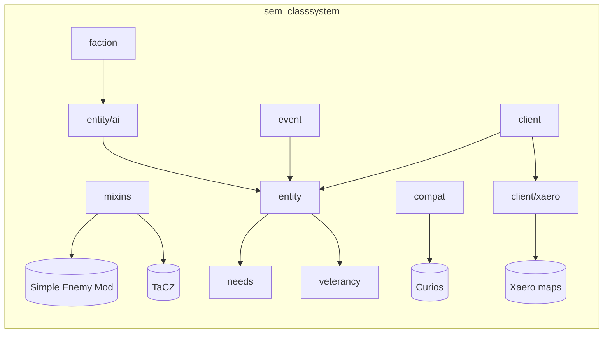

# Architecture

## Big picture

SEMC doesn't add its own armies from scratch — it **patches SEM's units**
(PMC/US/RU) through mixins and adds **two owned entity types** on top:
`BhqUnitEntity` (subclass of `PmcUnitEntity`, so it inherits SEM's pipeline
plus our layers) and `VdfUnitEntity` (standalone `PathfinderMob`, our own
combat/rendering — deliberately NOT a `Monster`).

## Source layout (`com.poseidon.sem_classsystem`)

| Package | Contents |
|---|---|
| `mixin/` | ~30 patches into SEM + TaCZ + Curios; `semcs$` prefix, `@Unique` private members; `AbstractSoftDepMixinPlugin` gates soft-dep mixins (Curios, Xaero) |
| `entity/` | `BhqUnitEntity`, `VdfUnitEntity`, `Squads`, `UnitAmmoService` |
| `entity/ai/` | SEM-unit goals (inject via `MixinAbstractUnitGoals`) + the VDF two-goal combat package |
| `event/` | Forge event handlers — targeting, hostility, needs ticks, night raids, veteran XP, garrison |
| `faction/` | `WeaponClass` (rifle/smg/shotgun/sniper/heavy/pistol/jack), `UnitClass`, loadout resolver, attribute scales |
| `data/` | `ClassLoadoutManager` — datapack reload listener |
| `needs/`, `veterancy/` | `UnitNeeds` NBT store; `UnitVeterancy` ranks |
| `client/` | Models, renderers, armor layers, procedural pose library, curio renderers, particles, screens |
| `client/xaero/` | Minimap/worldmap markers + routes — kept out of `client/` root so packets don't class-load Xaero |
| `block/`, `menu/` | Recruit tables, guard post, supply crate |
| `network/` | Forge SimpleChannel packets; client counts capped (`PacketAssignRoute.MAX_UNITS`) |
| `world/` | `SavedData` stores — chunk claims, unit names, event log, village defense state |
| `commands/`, `config/`, `registry/`, `compat/`, `bridge/` | CLI commands, Forge config, deferred registries, Curios/WTHIT integration, `IClassifiedUnit` |

## Rules that keep it working

- Mixins touch only SEM's own API-surface classes; injected member names get
  `semcs$` + `@Unique`.
- `ForgeRegistries.getKey` is nullable — always guarded.
- Curios/Xaero are soft deps: accessed behind `ModList.isLoaded(...)` or via
  dedicated compat classes that only load when present.
- `UnitAmmoService`/`UnitProceduralPoses` are plain classes (no weaving) so
  both mixin code and normal code can call them.
- Client-only classes never referenced from `entity/`, `config/`, `event/`,
  `network/` — the mixin config has a `client` section for those.
